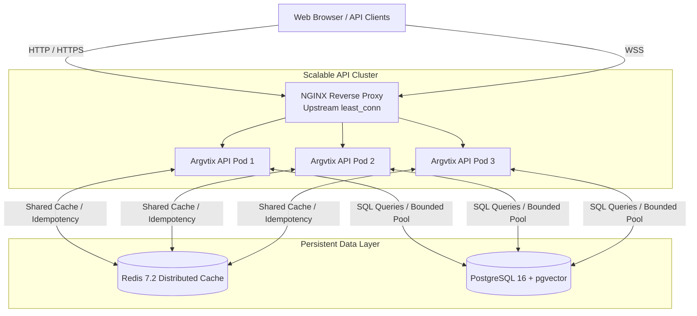
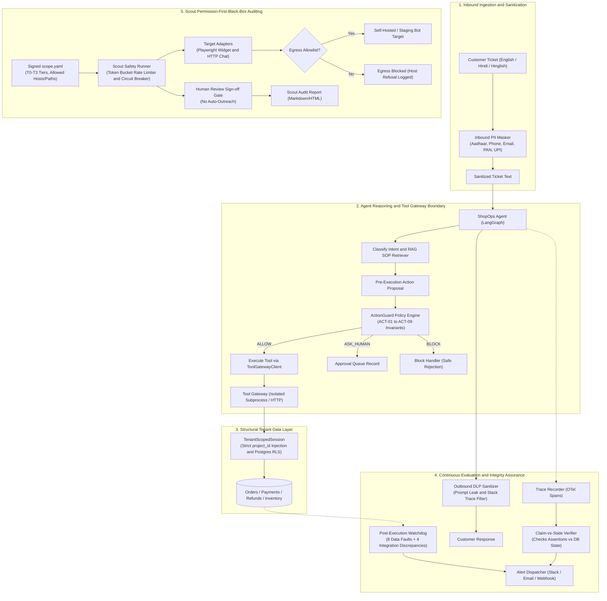

# Technical Architecture Document

**System Name:** Argvtix / ARGVTIX (Enterprise AI Reliability & Protection Platform)  
**Version:** 1.0.0  
**Target Environment:** Containerized Cloud Linux (Docker / Kubernetes) & Local Development  
**Document Owner:** Principal Software Engineer & Cloud Infrastructure Architect  
**Last Updated:** 2026-10-27  

---

## 1. Technology Stack

| Layer | Component / Tool | Version | Technical Justification |
| :--- | :--- | :--- | :--- |
| **Frontend Framework** | React + TypeScript | 18.3.1 / 5.7 | Type-safe single-page application (SPA) with high component reusability. |
| **Frontend Tooling** | Vite | 5.4.11 / 8.0 | Instant HMR development and optimized Rollup production bundles. |
| **Styling** | Vanilla CSS + Design Tokens | Custom | Zero-runtime CSS variables, high performance, strict brand consistency. |
| **Backend Framework** | FastAPI + Starlette | 0.115.8 | High-throughput asynchronous ASGI web framework with native Pydantic typing. |
| **Language Runtime** | Python | 3.12.9 | Native async/await, modern type hints, rich AI/ML ecosystem. |
| **Database Engine** | PostgreSQL / SQLite | PG 16 / SQLite 3 | PostgreSQL with pgvector for production; SQLite for local offline testing. |
| **ORM & Migrations** | SQLAlchemy + Alembic | 2.0.38 / 1.14.1 | Robust enterprise ORM with reversible DDL schema migrations. |
| **Caching Layer** | Redis + Process-Local LRU | Redis 7.2-alpine | Multi-tier caching with automatic fallback to local memory on failure. |
| **Reverse Proxy** | NGINX | 1.25-alpine | Upstream load balancing (`least_conn`), TLS termination, static asset caching. |
| **Task / Rate Limiting** | SlowAPI (Limits) | 0.1.9 | Token-bucket IP and token-based rate limiting on sensitive API routes. |
| **Testing Suites** | Pytest + Hypothesis | 8.3.4 / 6.170 | Unit, property-based invariant testing, and performance benchmark tests. |

---

## 2. Repository Structure

```
argvtix/
├── alembic/                  # Database migration scripts (001 -> 004 performance indexes)
│   ├── versions/             # Reversible migration files
│   └── env.py                # Alembic environment and SQLAlchemy metadata hook
├── bench/                    # Empirical benchmarking and stress testing framework
│   ├── benchmark_performance.py # Baseline query performance measurement suite
│   ├── load_test.py          # Asynchronous multi-profile load testing harness
│   └── final_performance_report.md # Comprehensive empirical performance audit
├── config/                   # Application settings and policy configurations
├── docs/                     # Core project documentation & architectural decision records
│   ├── adr/                  # 12 Architecture Decision Records (ADR-001 through ADR-012)
│   ├── PRD.md                # Product Requirements Document
│   ├── ARCHITECTURE.md       # Technical Architecture Specification (This Document)
│   ├── DESIGN_SYSTEM.md      # UI, Typography, and Component Guidelines
│   ├── PROJECT_MEMORY.md     # AI Context & Durable State Tracking
│   ├── AGENTS.md             # Permanent Coding & Security Guidelines
│   └── TASK_TRACKER.md       # Living Release & Feature Task Tracker
├── infra/                    # Reverse proxy, load balancing & infrastructure configuration
│   └── nginx.conf            # Upstream load balancing, caching headers, WebSocket proxy
├── src/                      # Backend application source code
│   └── argvtix/
│       ├── cache/            # Multi-tier caching architecture (LRU TTL + Redis)
│       ├── db/               # Database engine, models, and session management
│       ├── gateway/          # FastAPI entrypoint, middlewares, and REST/WS endpoints
│       ├── guard/            # Action Guard policy engine and tool gateway
│       ├── watchdog/         # Silent Data Corruption integrity rules & scanning engine
│       ├── security/         # Authentication, JWT, PII masking, and DLP filters
│       ├── trace/            # Distributed trace schemas and recording engine
│       ├── evals/            # Automated evaluation, judge calibration & CI gates
│       └── redteam/          # Automated prompt injection & adversarial attack suites
├── tests/                    # Complete automated test suite (320 tests)
│   ├── property/             # Hypothesis property-based guard invariant tests
│   ├── test_gateway/         # API endpoint integration and auth tests
│   ├── test_performance_resilience.py # Cache degradation & pool regression tests
│   └── test_watchdog/        # SQL integrity rule unit & integration tests
├── ui/                       # Frontend single-page application (React + Vite + TS)
│   ├── public/               # Static assets, sitemap.xml, robots.txt, og-preview.png
│   └── src/                  # React components, pages, custom hooks, and API client
├── Dockerfile                # Multi-stage hardened production Dockerfile
├── .dockerignore             # Production image isolation rules
├── docker-compose.prod.yml   # Multi-replica production stack with Redis & PostgreSQL
└── pyproject.toml            # Python packaging and dependency lock specification
```

---

## 3. System Architecture & Request Flows

### 3.1 High-Level Component Topology



### 3.2 Request & Interception Flow

1. **Client Ingestion:** Request arrives at NGINX; security headers and rate limits are checked.
2. **Middleware Pipeline:**
   - `SecurityHeadersMiddleware`: Injects CSP, HSTS, and frame protections.
   - `MaxPayloadSizeMiddleware`: Rejects requests exceeding 10MB to prevent memory exhaustion.
   - `CORSMiddleware`: Restricts origins to trusted domains (`https://app.argvtix.ai`, `localhost`).
3. **Action Guard Runtime Interception:**
   - Tool calls hit `POST /api/v1/guard/check`.
   - `ActionGuard` evaluates business parameters against configured thresholds.
   - If action is high-risk ($> \text{threshold}$), it is placed in `approval_queue` and returns `ASK_HUMAN`.
4. **Caching & Database Retrieval:**
   - Read requests (e.g., `GET /api/v1/traces/stats`) check `CacheManager`.
   - If cache hit: returns cached payload in $< 0.5\text{ ms}$.
   - If cache miss: executes collapsed SQL aggregation, writes result to cache with TTL, and returns.

---

### 3.3 End-to-End Enterprise Agent Outcome Assurance Topology



---

## 4. Database Design & Optimization

### 4.1 Core Schema Entities

- `Order`: Core financial order entity with status tracking (`pending`, `completed`, `cancelled`, `refunded`).
- `Payment`: Payment transactions tied to orders and customers.
- `Refund`: Issued refunds with status and amount.
- `LedgerEntry`: Financial double-entry tracking customer wallet balances (`credit` / `debit`).
- `TraceRecord`: Executed AI workflows with input prompt, agent response, latency, and cost.
- `TraceStepRecord`: Granular steps inside a trace (tool calls, LLM queries, retrieval).
- `WatchdogFindingRecord`: Detected business data integrity anomalies.
- `ApprovalQueueRecord`: Pending human-in-the-loop approval actions with idempotency keys.

### 4.2 Composite & Status Indexing Strategy
To eliminate full-table scans, 12 composite and status indexes are established via Alembic:
- `ix_orders_customer_created` (`customer_id`, `created_at`)
- `ix_orders_status_created` (`status`, `created_at`)
- `ix_payments_order_status` (`order_id`, `status`)
- `ix_refunds_order_status` (`order_id`, `status`)
- `ix_ledger_customer_type` (`customer_id`, `entry_type`)
- `ix_traces_workflow_created` (`workflow_type`, `started_at`)
- `ix_watchdog_resolved_detected` (`resolved`, `detected_at`)
- `ix_approval_status_created` (`status`, `created_at`)

### 4.3 Connection Pooling & Resilience
- Bounded pool: `pool_size = 15`, `max_overflow = 10`.
- Connection liveness: `pool_pre_ping = True` (recycles dropped connections automatically).
- Connection recycling: `pool_recycle = 1800` (refreshes connections every 30 minutes).

---

## 5. API Design & Security Boundaries

### 5.1 Route Taxonomy

| Endpoint | Method | Auth Level | Description |
| :--- | :--- | :--- | :--- |
| `/health` | `GET` | Public | System health check, DB connectivity, and pool metrics. |
| `/api/v1/auth/token` | `POST` | Public | Authenticates credentials and issues signed JWT bearer tokens. |
| `/api/v1/contact` | `POST` | Public (Rate Limited) | Contact form submission with spam protection. |
| `/api/v1/traces/stats` | `GET` | Public (Cached) | High-performance aggregated metrics of traces. |
| `/api/v1/traces` | `GET`, `POST`| Operator+ | Ingests or queries agent execution traces. |
| `/api/v1/guard/check` | `POST` | Operator+ | Pre-action safety guardrail evaluation. |
| `/api/v1/guard/approvals` | `GET` | Operator+ | Retrieves pending human approval requests. |
| `/api/v1/guard/approvals/{id}/approve` | `POST` | Admin | Authorizes an approval request. |
| `/api/v1/watchdog/scan` | `POST` | Operator+ | Runs integrity scan across business tables. |
| `/api/v1/cache/metrics` | `GET` | Public | Real-time cache hit/miss ratio observability. |

---

## 6. Infrastructure & Deployment Architecture

### 6.1 Multi-Stage Containerization
- **Builder Stage:** Resolves wheels and compiles dependencies without retaining dev toolchains.
- **Runtime Stage:** Non-root execution (`appuser:appgroup`), read-only source files, native health checks.
- **Zero Secrets in Images:** All environment secrets are passed via environment variables at runtime.

### 6.2 Environment Variables (Names Only)
- `DATABASE_URL`: Connection string for PostgreSQL or SQLite.
- `REDIS_URL`: Connection string for distributed Redis cache.
- `ARGVTIX_JWT_SECRET`: Secret key for signing HMAC-SHA256 JWT tokens.
- `ARGVTIX_AUTH_ENABLED`: Toggles authentication enforcement (default `true`).
- `ARGVTIX_ALLOWED_ORIGINS`: Comma-delimited CORS origin whitelist.
- `CLOUDFLARE_TURNSTILE_SECRET_KEY`: Secret for verifying Cloudflare Turnstile CAPTCHA tokens.
- `DB_POOL_SIZE`, `DB_MAX_OVERFLOW`, `DB_POOL_TIMEOUT`, `DB_POOL_RECYCLE`: Database connection pool limits.
